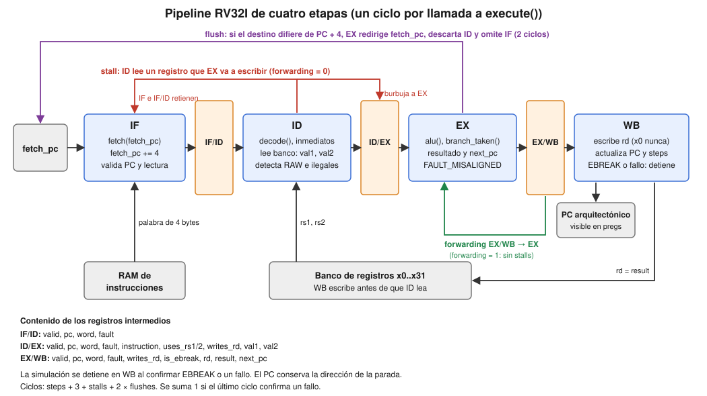

# Pruebas de los cores RV32I

## Atomic

Los valores de esta sección parten de una sesión nueva, con los registros en cero y el programa cargado en `0x0`. Los registros que no se enumeran conservan su valor inicial. Un **step** cuenta una instrucción completada, incluido `ebreak`. Un **cycle** cuenta una llamada a `execute()`, incluso cuando la instrucción falla. El PC queda en la instrucción que causó la parada.

### Cómo ejecutar

En PowerShell, desde la raíz del proyecto, compila y abre una sesión nueva por programa. Cambia la ruta de `program=` por la del archivo que quieras probar.

```powershell
.\bin\make.bat rv32-atomic
.\simics.bat targets\rv32i\rv32-atomic.simics program=targets/rv32i/programs/atomic/01-arranque.txt
```

Para los programas que cargan correctamente, usa estos comandos en Simics. Los casos 08 y 09 de las pruebas de ejecución requieren la preparación indicada más abajo.

```text
run 64 cycles
pregs
ptime
quit
```

Las pruebas de RAM comprueban la carga y extracción de instrucciones. El subconjunto de [CONVENTIONS.md](CONVENTIONS.md) cubre el uso de RAM como memoria de instrucciones.

### Programas que terminan en EBREAK

| Programa | Qué comprueba | Estado esperado al parar |
| --- | --- | --- |
| [01 · Arranque](targets/rv32i/programs/atomic/01-arranque.txt) | Carga, orden de bytes, extracción y decodificación de ADDI, escritura de `x1` y parada en EBREAK. | `x0=0`, `x1=5`, PC `0x04`. **2 steps, 2 cycles**. |
| [02 · Límites de la ALU](targets/rv32i/programs/atomic/02-alu-limites.txt) | La suma y resta conservan los 32 bits bajos. Comprueba las comparaciones con y sin signo, la extensión de signo en SLTIU, los desplazamientos de 0 y 31 posiciones y la protección de `x0`. | `x0=0`, `x1=0xffffffff`, `x2=0`, `x3=1`, `x4=0`, `x5=0`, `x6=0xffffffff`, `x7=1`, `x8=0x80000000`, `x9=0x7fffffff`, `x10=1`. PC `0x2c`. **12 steps, 12 cycles**. |
| [03 · Bucle](targets/rv32i/programs/atomic/03-bucle.txt) | BNE en `0x08` vuelve dos veces a `0x04` con offset `-4`. Cuando `x1` llega a cero, continúa en `0x0c`. | `x1=0`, `x2=7`, PC `0x10`. **9 steps, 9 cycles**. |
| [04 · Enlace](targets/rv32i/programs/atomic/04-enlace.txt) | JAL salta a `0x0c` y guarda el enlace en `x5`. JALR lee el valor anterior de `x6` (5), limpia su bit 0 para volver a `0x04` y escribe el nuevo enlace en ese mismo registro. | `x5=0x04`, `x6=0x14`, `x9=1`, PC `0x08`. **5 steps, 5 cycles**. |
| [Todas las instrucciones](targets/rv32i/programs/all-instructions.txt) | Integra las 30 instrucciones del ejercicio. Ejercita las seis condiciones de branch tanto tomadas como no tomadas, JAL y JALR, y un intento de escribir en `x0`. | PC `0xd4`. **46 steps, 46 cycles**. El estado completo aparece abajo. |

En **01 · Arranque**, antes de ejecutar, `x 0x0 8` debe mostrar `9300 5000 7300 1000`. Corresponde a las palabras `0x00500093` y `0x00100073`. `disassemble 0x0 2` debe mostrar `addi x1, x0, 5` y `ebreak`. Si ejecutas un solo ciclo desde el arranque, `pregs` ya debe mostrar `x1=5` y PC `0x04`.

En **02 · Límites de la ALU**, `x3=1` y `x4=0` distinguen la comparación de `0xffffffff` con cero interpretada con y sin signo. `x6=0xffffffff` y `x7=1` distinguen SRAI de SRLI con los mismos operandos.

En **Todas las instrucciones**, `x23=6` registra las seis caídas al siguiente PC y `x24=0` confirma que se saltaron las instrucciones señuelo. Los enlaces de JAL y JALR quedan en `x25=0xbc` y `x27=0xc8`. Este es el estado final de referencia para comparar los cores.

```text
x0  = 0x00000000   x1  = 0x12345000   x2  = 0x00000004   x3  = 0x00000064
x4  = 0xfffffff9   x5  = 0x00000001   x6  = 0x00000000   x7  = 0x0000009b
x8  = 0x00000764   x9  = 0x000000f0   x10 = 0x00000640   x11 = 0x0000000f
x12 = 0xfffffffc   x13 = 0x0000005d   x14 = 0xffffff95   x15 = 0x000000c8
x16 = 0x00000001   x17 = 0x00000000   x18 = 0xffffff9d   x19 = 0x7ffffffc
x20 = 0xfffffffc   x21 = 0x000000f4   x22 = 0x00000060   x23 = 0x00000006
x24 = 0x00000000   x25 = 0x000000bc   x26 = 0x000000c0   x27 = 0x000000c8
x28 = 0x00000064   x29 = 0x00000000   x30 = 0x00000000   x31 = 0x00000000
pc  = 0x000000d4
```

### Errores de carga

Cada archivo contiene un ADDI válido antes de la instrucción defectuosa. Simics debe reportar un `ValueError` con el nombre del archivo y la línea 3 al intentar cargarlo. La prueba termina en ese diagnóstico, antes de ejecutar el programa.

| Programa | Qué comprueba | Diagnóstico esperado |
| --- | --- | --- |
| [01 · Registro fuera de rango](targets/rv32i/programs/atomic/negativas/01-registro-fuera-de-rango.txt) | Rechaza `x32`. El banco contiene `x0` a `x31`. | `Value 32 out of range [0, 31]` |
| [02 · Inmediato fuera de rango](targets/rv32i/programs/atomic/negativas/02-inmediato-fuera-de-rango.txt) | Rechaza `2048` en ADDI. El inmediato con signo usa 12 bits. | `Value 2048 out of range [-2048, 2047]` |
| [03 · Desplazamiento fuera de rango](targets/rv32i/programs/atomic/negativas/03-desplazamiento-fuera-de-rango.txt) | Rechaza un desplazamiento inmediato de 32 en SLLI. El campo admite 0 a 31. | `Value 32 out of range [0, 31]` |
| [04 · Offset impar](targets/rv32i/programs/atomic/negativas/04-offset-impar.txt) | Rechaza el offset `3` en BEQ. El formato B solo codifica offsets pares. | `Branch offset must be even: 3` |

### Errores de ejecución y caso de control

Los offsets pares del formato B o J pueden producir destinos que no son múltiplos de cuatro. Por eso los casos 05 a 07 pasan el cargador y ponen a prueba el core.

| Programa | Qué comprueba | Resultado esperado |
| --- | --- | --- |
| [05 · Branch desalineado](targets/rv32i/programs/atomic/negativas/05-branch-desalineado.txt) | BEQ se toma desde `0x04` hacia `0x06`. La instrucción siguiente queda sin ejecutar. | `unaligned instruction fetch`. PC `0x04`, `x1=5`, `x2=0`. **1 step, 2 cycles**. |
| [06 · JAL desalineado](targets/rv32i/programs/atomic/negativas/06-jal-desalineado.txt) | JAL intenta saltar a `0x06`. Comprueba que la detección ocurre antes de sobrescribir el enlace en `x5`. | `unaligned instruction fetch`. PC `0x04`, `x5=7`, `x2=0`. **1 step, 2 cycles**. |
| [07 · Branch no tomado](targets/rv32i/programs/atomic/negativas/07-branch-no-tomado.txt) | BNE compara un registro consigo mismo y continúa por `0x08`, aunque el destino codificado sea `0x06`. | Parada en `ebreak`. PC `0x0c`, `x1=5`, `x2=9`. **4 steps, 4 cycles**. |
| [08 · Palabra ilegal](targets/rv32i/programs/atomic/negativas/08-palabra-ilegal.txt) | Con la inyección indicada abajo, el decodificador encuentra una palabra con el opcode y funct3 de SLLI, pero con funct7 inválido. | `illegal or unsupported instruction 0x02101113 at 0x00000004`. PC `0x04`, `x1=5`, `x2=0`. **1 step, 2 cycles**. |
| [09 · Fuera de RAM](targets/rv32i/programs/atomic/negativas/09-fuera-de-ram.txt) | JAL fija el PC en `0x10`. Con 16 bytes de RAM, la lectura siguiente falla. | `instruction fetch failed`. PC `0x10`, `x1=5`, `x2=0`. **2 steps, 3 cycles**. |

Para el **caso 08**, sustituye la instrucción en `0x04` en la CLI de Simics tras cargar el archivo y antes de ejecutar. El segundo comando debe mostrar `.word 0x02101113`.

```text
@SIM_write_phys_memory(conf.core0, 0x4, 0x02101113, 4)
disassemble 0x4 1
```

Para el **caso 09**, agrega `ram_size=0x10` al comando de arranque en PowerShell. Las cuatro palabras del programa ocupan toda la RAM desde `0x00` hasta `0x0f`. El JAL se completa y el siguiente ciclo es el que falla.

### Resultados observados

En Simics 7, los cinco programas positivos terminaron en el PC esperado con los registros y contadores indicados. Los cuatro archivos inválidos fueron rechazados en la línea 3. Los cinco casos de ejecución coincidieron con el diagnóstico, los registros y los contadores de la tabla, incluido el caso 07 que terminó normalmente.

## Pipeline

El core `rv32-pipeline` ejecuta el mismo subconjunto de [CONVENTIONS.md](CONVENTIONS.md), carga los mismos programas con el mismo `txt_loader.py` y debe dejar el mismo estado final que el core atómico. Tiene cuatro etapas (**IF → ID → EX → WB**) separadas por tres registros intermedios; el diagrama está en [docs/pipeline-arquitectura.svg](docs/pipeline-arquitectura.svg).



Los contadores significan lo mismo que en el core atómico, con una precisión:

- Un **cycle** es una llamada a `execute()`, incluso cuando entra una burbuja, hay un stall o el pipeline se está llenando.
- Un **step** es una instrucción confirmada en WB, incluido `ebreak`. Los fallos no cuentan como step, y una instrucción del camino descartado nunca llega a contarse.
- El PC de `pregs` es el **PC arquitectónico**: la siguiente instrucción que debe confirmarse, o la que causó la parada. Se actualiza en WB. La dirección que lee IF (`fetch_pc`) es interna y va por delante.

Con N instrucciones sin riesgos el programa tarda N + 3 ciclos (el llenado). En general:

```text
cycles = steps + 3 + stalls + 2 × flushes        (+1 si el programa termina en un fallo)
```

Los stalls solo existen con interlock. Cada flush (branch tomado, JAL o JALR) cuesta 2 ciclos porque EX descarta lo que había en ID y lo que IF iba a leer. El +1 de los fallos es la instrucción defectuosa, que ocupa WB un ciclo sin contar como step.

### Cómo ejecutar

La regresión completa corre cada programa en una sesión nueva en tres modos (monociclo, pipeline con interlock y pipeline con forwarding), compara el estado contra el monociclo y los ciclos contra [regresion-esperado.csv](targets/rv32i/regresion-esperado.csv), revisa las trazas de riesgos y comprueba los cuatro errores de carga. Desde la raíz del proyecto, después de compilar ambos módulos:

```powershell
.\bin\make.bat rv32-atomic
.\bin\make.bat rv32-pipeline
.\targets\rv32i\regresion.ps1
```

Deja la salida completa de cada corrida y el resumen en `regresion-salida\` (`resultados.md`). `-Filtro "^h0[1-5]"` limita los casos y `-Simics` cambia la ruta de `simics.bat`.

Para una sola corrida, [regresion.simics](targets/rv32i/regresion.simics) hace `run`, `pregs` y `ptime` en secuencia. Dentro de un script cada comando espera a que termine el anterior, así que los contadores se leen con la simulación detenida. Si pegas `run`, `pregs` y `ptime` juntos en la consola, Simics los ejecuta antes de que termine el `run` y salen ceros.

```powershell
.\simics.bat targets\rv32i\regresion.simics core_kind=pipeline forwarding=1 program=targets/rv32i/programs/pipeline/h01-raw-addi.txt
```

Los parámetros son `core_kind` (`atomic` o `pipeline`), `forwarding` (0 o 1), `log_level` (3 imprime la traza por ciclo), `max_cycles`, y los de `rv32.simics` (`program`, `load_address`, `ram_size`). Para el caso 08 de las pruebas negativas, `inject_addr=0x4 inject_word=0x02101113` hace la inyección de memoria. Para el 09, `ram_size=0x10`.

En una sesión interactiva el interruptor se fija antes de ejecutar y no aparece en `pregs`:

```text
log-level 3
core0->forwarding = 1
run 100 cycles
```

### Programas específicos del pipeline

Cada programa H trae en su primera línea el estado esperado. Los stalls son los del interlock; con forwarding todos son 0.

| Programa | Qué comprueba | Estado esperado al parar | Stalls · flushes | Ciclos interlock / forwarding |
| --- | --- | --- | --- | --- |
| [H01](targets/rv32i/programs/pipeline/h01-raw-addi.txt) | RAW entre dos ADDI consecutivos. Es la traza de espera por dependencia del reporte. | `x1=10`, `x2=15`, PC `0x08`. 3 steps. | 1 · 0 | 7 / 6 |
| [H02](targets/rv32i/programs/pipeline/h02-raw-add-sub.txt) | Dos RAW de distancia 1 seguidos (`x2→x3`, `x3→x4`). | `x1=6`, `x2=2`, `x3=8`, `x4=2`, PC `0x10`. 5 steps. | 2 · 0 | 10 / 8 |
| [H03](targets/rv32i/programs/pipeline/h03-raw-rs2.txt) | RAW solo por `rs2`; `rs1` está a distancia 2. | `x1=4`, `x2=9`, `x3=0xfffffffb`, PC `0x0c`. 4 steps. | 1 · 0 | 8 / 7 |
| [H04](targets/rv32i/programs/pipeline/h04-mismo-registro.txt) | Cadena sobre el mismo registro (`rd = rs1`) en tres instrucciones. | `x1=10`, PC `0x10`. 5 steps. | 3 · 0 | 11 / 8 |
| [H05](targets/rv32i/programs/pipeline/h05-distancia-2.txt) | Productor a distancia 2: WB escribe antes de que ID lea, no hay stall. | `x1=5`, `x2=6`, `x3=10`, PC `0x0c`. 4 steps. | 0 · 0 | 7 / 7 |
| [H06](targets/rv32i/programs/pipeline/h06-branch-dependiente.txt) | BEQ tomado cuyos operandos acaban de calcularse (RAW y flush juntos). | `x1=3`, `x2=3`, `x3=0`, `x4=4`, PC `0x14`. 5 steps. | 2 · 1 | 12 / 10 |
| [H07](targets/rv32i/programs/pipeline/h07-jalr-dependiente.txt) | JALR cuyo `rs1` acaba de calcularse. Descarta dos instrucciones. | `x1=16`, `x2=8`, `x3=0`, `x4=4`, PC `0x14`. 4 steps. | 1 · 1 | 10 / 9 |
| [H08](targets/rv32i/programs/pipeline/h08-dos-operandos.txt) | La misma dependencia en `rs1` y `rs2` cuenta un solo stall. | `x1=3`, `x2=6`, PC `0x08`. 3 steps. | 1 · 0 | 7 / 6 |
| [H09](targets/rv32i/programs/pipeline/h09-x0-sin-dependencia.txt) | `x0` nunca genera dependencia, ni como destino ni como fuente. | `x0=0`, `x1=0`, `x2=1`, `x3=0`, PC `0x10`. 5 steps. | 0 · 0 | 8 / 8 |
| [H10](targets/rv32i/programs/pipeline/h10-branch-tomado.txt) | BNE tomado con dos instrucciones del camino equivocado en vuelo. Es la traza de flush del reporte. | `x1=1`, `x2=0`, `x3=0`, `x4=4`, `x9=9`, PC `0x18`. 5 steps. | 0 · 1 | 10 / 10 |
| [H11](targets/rv32i/programs/pipeline/h11-ebreak-descartado.txt) | Un `ebreak` en el camino descartado (`0x0c`) no detiene el programa. | `x1=1`, `x2=0`, `x3=3`, `x4=4`, PC `0x18`. 5 steps. | 0 · 1 | 10 / 10 |
| [H12](targets/rv32i/programs/pipeline/h12-branch-no-tomado.txt) | BEQ con RAW que no se toma: no hay flush y se ejecutan las dos siguientes. | `x1=1`, `x2=2`, `x3=3`, `x4=4`, PC `0x14`. 6 steps. | 1 · 0 | 10 / 9 |
| [P01](targets/rv32i/programs/pipeline/p01-independientes.txt) | Línea recta de 25 instrucciones sin dependencias de distancia 1. Incluye un ADDI sobre `x0`. | Ver abajo. PC `0x60`. 25 steps. | 0 · 0 | 28 / 28 |

Estado final de P01 (los registros que no se listan quedan en cero, entre ellos `x0`, `x8` y `x16`):

```text
x1  = 0x00000064   x2  = 0xfffffff9   x3  = 0x12345000   x4  = 0x00000005
x5  = 0x0000005d   x6  = 0x0000005f   x7  = 0x00000001   x9  = 0xffffff9d
x10 = 0x00000065   x11 = 0x00000060   x12 = 0x00000c80   x13 = 0x07ffffff
x14 = 0xffffffff   x15 = 0x00000001   x17 = 0x0000009b   x18 = 0x0000006f
x19 = 0x00000079   x20 = 0x00000028   x21 = 0x0fffffff   x22 = 0xffffffff
x23 = 0x00001058   pc  = 0x00000060
```

`x23` es el AUIPC en `0x58` con 1 como inmediato superior: `0x58 + 0x1000`.

### Programas del core atómico en el pipeline

Los programas de la sección [Atomic](#atomic) deben dejar en el pipeline **el mismo estado**: registros, PC, steps y motivo de parada, con y sin forwarding. Solo cambian los ciclos. Esto incluye los cinco positivos, los casos de ejecución 05 a 09 (con la inyección del 08 y `ram_size=0x10` en el 09) y los cuatro errores de carga, que rechaza el mismo cargador antes de ejecutar. El criterio de aceptación es que `regresion.ps1` no reporte diferencias.

### Comparación de ciclos

Una corrida por programa, desde una sesión nueva. Los steps son iguales en los tres modos.

| Programa | Steps | Monociclo | Pipeline con interlock | Pipeline con forwarding | Stalls (interlock) | Flushes |
| --- | ---: | ---: | ---: | ---: | ---: | ---: |
| [01 · Arranque](targets/rv32i/programs/atomic/01-arranque.txt) | 2 | 2 | 5 | 5 | 0 | 0 |
| [02 · Límites de la ALU](targets/rv32i/programs/atomic/02-alu-limites.txt) | 12 | 12 | 18 | 15 | 3 | 0 |
| [03 · Bucle](targets/rv32i/programs/atomic/03-bucle.txt) | 9 | 9 | 20 | 16 | 4 | 2 |
| [04 · Enlace](targets/rv32i/programs/atomic/04-enlace.txt) | 5 | 5 | 13 | 12 | 1 | 2 |
| [Todas las instrucciones](targets/rv32i/programs/all-instructions.txt) | 46 | 46 | 67 | 65 | 2 | 8 |
| [Neg. 05 · Branch desalineado](targets/rv32i/programs/atomic/negativas/05-branch-desalineado.txt) | 1 | 2 | 6 | 5 | 1 | 0 |
| [Neg. 06 · JAL desalineado](targets/rv32i/programs/atomic/negativas/06-jal-desalineado.txt) | 1 | 2 | 5 | 5 | 0 | 0 |
| [Neg. 07 · Branch no tomado](targets/rv32i/programs/atomic/negativas/07-branch-no-tomado.txt) | 4 | 4 | 8 | 7 | 1 | 0 |
| [Neg. 08 · Palabra ilegal](targets/rv32i/programs/atomic/negativas/08-palabra-ilegal.txt) | 1 | 2 | 5 | 5 | 0 | 0 |
| [Neg. 09 · Fuera de RAM](targets/rv32i/programs/atomic/negativas/09-fuera-de-ram.txt) | 2 | 3 | 8 | 8 | 0 | 1 |
| [H01](targets/rv32i/programs/pipeline/h01-raw-addi.txt) | 3 | 3 | 7 | 6 | 1 | 0 |
| [H02](targets/rv32i/programs/pipeline/h02-raw-add-sub.txt) | 5 | 5 | 10 | 8 | 2 | 0 |
| [H03](targets/rv32i/programs/pipeline/h03-raw-rs2.txt) | 4 | 4 | 8 | 7 | 1 | 0 |
| [H04](targets/rv32i/programs/pipeline/h04-mismo-registro.txt) | 5 | 5 | 11 | 8 | 3 | 0 |
| [H05](targets/rv32i/programs/pipeline/h05-distancia-2.txt) | 4 | 4 | 7 | 7 | 0 | 0 |
| [H06](targets/rv32i/programs/pipeline/h06-branch-dependiente.txt) | 5 | 5 | 12 | 10 | 2 | 1 |
| [H07](targets/rv32i/programs/pipeline/h07-jalr-dependiente.txt) | 4 | 4 | 10 | 9 | 1 | 1 |
| [H08](targets/rv32i/programs/pipeline/h08-dos-operandos.txt) | 3 | 3 | 7 | 6 | 1 | 0 |
| [H09](targets/rv32i/programs/pipeline/h09-x0-sin-dependencia.txt) | 5 | 5 | 8 | 8 | 0 | 0 |
| [H10](targets/rv32i/programs/pipeline/h10-branch-tomado.txt) | 5 | 5 | 10 | 10 | 0 | 1 |
| [H11](targets/rv32i/programs/pipeline/h11-ebreak-descartado.txt) | 5 | 5 | 10 | 10 | 0 | 1 |
| [H12](targets/rv32i/programs/pipeline/h12-branch-no-tomado.txt) | 6 | 6 | 10 | 9 | 1 | 0 |
| [P01](targets/rv32i/programs/pipeline/p01-independientes.txt) | 25 | 25 | 28 | 28 | 0 | 0 |

El forwarding elimina todos los stalls (`all-instructions` baja de 2 a 0), pero los ciclos que más pesan siguen siendo el llenado del pipeline y los flushes de los saltos (8 en `all-instructions`). En los programas de línea recta sin dependencias (`01`, `P01`) el interlock y el forwarding empatan. Donde hay cadenas de dependencias (`H02`, `H04`, `03`) el forwarding recupera un ciclo por cada stall.

### Verificación por etapa

Con `log-level 3` cada ciclo imprime qué instrucción ocupa IF, ID, EX y WB, y una línea adicional cuando ocurre un `stall:`, un `forward:` o un `flush:`. Un caso dirigido por etapa:

| Etapa | Qué se comprueba | Caso | Qué debe verse |
| --- | --- | --- | --- |
| IF | Palabra y PC leídos. | [01 · Arranque](targets/rv32i/programs/atomic/01-arranque.txt). `x 0x0 8` antes de correr, traza al correr. | `x 0x0 8` muestra `9300 5000 7300 1000`. En el segundo ciclo, `IF: 00000004 ID: 00000000 addi x1, x0, 5`: la palabra de `0x0` llegó a ID y IF avanzó 4. |
| IF | Fallo de lectura (fuera de RAM). | [Neg. 09](targets/rv32i/programs/atomic/negativas/09-fuera-de-ram.txt) con `ram_size=0x10`. | `FETCH-FAIL` viaja por ID, EX y WB con `IF: (detenida)`. Para en WB con `instruction fetch failed` y PC `0x10`. |
| ID | Campos e inmediatos decodificados (incluidos los negativos). | [03 · Bucle](targets/rv32i/programs/atomic/03-bucle.txt) y [H10](targets/rv32i/programs/pipeline/h10-branch-tomado.txt). | En ID aparecen `addi x1, x1, -1`, `bne x1, x0, -4` y `bne x1, x0, 12` con sus registros e inmediatos. |
| ID | Palabra ilegal y lectura de operandos con espera. | [Neg. 08](targets/rv32i/programs/atomic/negativas/08-palabra-ilegal.txt) con la inyección. [H01](targets/rv32i/programs/pipeline/h01-raw-addi.txt) con interlock. | `ID: 00000004 .word 0x02101113` y luego `illegal or unsupported instruction 0x02101113 at 0x00000004`. En H01, `stall: 00000004 addi espera un registro que EX esta calculando`. |
| EX | Resultado y operando correctos. | [02 · Límites de la ALU](targets/rv32i/programs/atomic/02-alu-limites.txt). [H01](targets/rv32i/programs/pipeline/h01-raw-addi.txt) con forwarding. | Los registros finales coinciden con el core atómico. Con forwarding, `forward: 00000004 x1 <- 0000000a (EX/WB)`. |
| EX | Destino de saltos y alineación. | [H10](targets/rv32i/programs/pipeline/h10-branch-tomado.txt), [H07](targets/rv32i/programs/pipeline/h07-jalr-dependiente.txt), [Neg. 05](targets/rv32i/programs/atomic/negativas/05-branch-desalineado.txt). | `flush: salto de 00000008 a 00000014` (H10) y `flush: salto de 00000004 a 00000010` (H07). En el 05, `unaligned instruction fetch` con PC `0x04`. |
| WB | Escritura del banco, `x0` y steps. | [P01](targets/rv32i/programs/pipeline/p01-independientes.txt) y [H09](targets/rv32i/programs/pipeline/h09-x0-sin-dependencia.txt). [H11](targets/rv32i/programs/pipeline/h11-ebreak-descartado.txt). | `x0=0` aunque el programa haga `addi x0, x1, 5` o `addi x0, x0, 5`. `ptime` muestra 25 steps en P01. En H11, el `ebreak` de `0x0c` no para el programa: para el de `0x18` con 5 steps. |

`regresion.ps1` comprueba automáticamente las líneas de traza de H01, H05, H09, H10, H11, H12, 01, Neg. 08 y Neg. 09, además de los registros y contadores de todos los programas.

### Llenado, vaciado y PC inicial distinto de cero

**Llenado y vaciado.** [01 · Arranque](targets/rv32i/programs/atomic/01-arranque.txt) tiene 2 instrucciones y tarda **5 ciclos**: 2 de instrucciones más 3 de llenado. La traza muestra primero una sola etapa ocupada, luego dos, tres y cuatro a la vez. Al llegar el `ebreak` a WB el pipeline se vacía y el PC queda en `0x04`.

**PC inicial.** Para comprobar que IF extrae desde `load_address` y que `rv32_set_pc()` reinicia el pipeline desde ahí, se agrega `load_address=0x100` al comando de arranque. Los programas elegidos solo usan saltos relativos, así que el estado final es el mismo salvo los enlaces de JAL y JALR, que guardan direcciones desplazadas `0x100`. Los ciclos no cambian:

| Programa con `load_address=0x100` | PC final | Steps | Ciclos monociclo / interlock / forwarding |
| --- | --- | ---: | --- |
| 01 · Arranque | `0x104` | 2 | 2 / 5 / 5 |
| 03 · Bucle | `0x110` | 9 | 9 / 20 / 16 |
| 04 · Enlace (`x5=0x104`, `x6=0x114`) | `0x108` | 5 | 5 / 13 / 12 |
| H10 | `0x118` | 5 | 5 / 10 / 10 |

```powershell
.\simics.bat targets\rv32i\rv32-pipeline.simics program=targets/rv32i/programs/atomic/01-arranque.txt load_address=0x100
```

### Trazas de referencia

Espera por dependencia (H01, interlock). El `stall:` aparece en el ciclo en que `addi x2, x1, 5` está en ID y `addi x1, x0, 10` en EX; al ciclo siguiente entra una burbuja a EX y la instrucción dependiente se repite en ID. 3 steps, 7 cycles.

```text
[core0 info]  IF: 00000000 ID: ---------------- EX: ---------------- WB: ----------------
[core0 info]  IF: 00000004 ID: 00000000 addi x1, x0, 10 EX: ---------------- WB: ----------------
[core0 info]  IF: 00000008 ID: 00000004 addi x2, x1, 5 EX: 00000000 addi x1, x0, 10 WB: ----------------
[core0 info] stall: 00000004 addi espera un registro que EX esta calculando
[core0 info]  IF: 00000008 ID: 00000004 addi x2, x1, 5 EX: ---------------- WB: 00000000 addi x1, x0, 10
[core0 info]  IF: 0000000c ID: 00000008 ebreak EX: 00000004 addi x2, x1, 5 WB: ----------------
[core0 info]  IF: 00000010 ID: 0000000c .word 0x00000000 EX: 00000008 ebreak WB: 00000004 addi x2, x1, 5
[core0 info]  IF: 00000014 ID: 00000010 .word 0x00000000 EX: 0000000c .word 0x00000000 WB: 00000008 ebreak
[core0 info] halted at pc 0x00000008: ebreak
```

Forwarding (H01, `core0->forwarding = 1`). No hay `stall:`; `addi x2, x1, 5` toma `x1` de EX/WB mientras está en EX. 3 steps, 6 cycles.

```text
[core0 info]  IF: 00000000 ID: ---------------- EX: ---------------- WB: ----------------
[core0 info]  IF: 00000004 ID: 00000000 addi x1, x0, 10 EX: ---------------- WB: ----------------
[core0 info]  IF: 00000008 ID: 00000004 addi x2, x1, 5 EX: 00000000 addi x1, x0, 10 WB: ----------------
[core0 info]  IF: 0000000c ID: 00000008 ebreak EX: 00000004 addi x2, x1, 5 WB: 00000000 addi x1, x0, 10
[core0 info] forward: 00000004 x1 <- 0000000a (EX/WB)
[core0 info]  IF: 00000010 ID: 0000000c .word 0x00000000 EX: 00000008 ebreak WB: 00000004 addi x2, x1, 5
[core0 info]  IF: 00000014 ID: 00000010 .word 0x00000000 EX: 0000000c .word 0x00000000 WB: 00000008 ebreak
[core0 info] halted at pc 0x00000008: ebreak
```

Flush (H10). El `bne` de `0x08` está en EX con `addi x2, x0, 99` (`0x0c`) en ID y `0x10` por leerse. EX redirige a `0x14` y descarta ambas: `x2` y `x3` quedan en cero. 5 steps, 10 cycles.

```text
[core0 info]  IF: 00000010 ID: 0000000c addi x2, x0, 99 EX: 00000008 bne x1, x0, 12 WB: 00000004 addi x9, x0, 9
[core0 info] flush: salto de 00000008 a 00000014, se descartan ID e IF
[core0 info]  IF: 00000014 ID: ---------------- EX: ---------------- WB: 00000008 bne x1, x0, 12
[core0 info]  IF: 00000018 ID: 00000014 addi x4, x0, 4 EX: ---------------- WB: ----------------
[core0 info]  IF: 0000001c ID: 00000018 ebreak EX: 00000014 addi x4, x0, 4 WB: ----------------
[core0 info]  IF: 00000020 ID: 0000001c .word 0x00000000 EX: 00000018 ebreak WB: 00000014 addi x4, x0, 4
[core0 info]  IF: 00000024 ID: 00000020 .word 0x00000000 EX: 0000001c .word 0x00000000 WB: 00000018 ebreak
[core0 info] halted at pc 0x00000018: ebreak
```

### Decisión: cuatro etapas, sin MEM

El enunciado pide cuatro etapas y la diapositiva 3 de [Presentacion-rv32i.pdf](Presentacion-rv32i.pdf) menciona cinco. Se implementaron cuatro: **extracción (IF), decodificación y lectura de registros (ID), ejecución (EX) y escritura (WB)**. No hay etapa de memoria porque el subconjunto de [CONVENTIONS.md](CONVENTIONS.md) no tiene `lw` ni `sw`: ninguna instrucción accede a memoria de datos. Una etapa MEM solo pasaría el resultado sin hacer nada, y costaría un ciclo más de latencia por programa (N + 4 en vez de N + 3) y otro registro intermedio, sin cambiar ninguna dependencia de datos ni la penalización de los saltos, que se resuelven en EX.

Con cuatro etapas hay dos distancias de dependencia que cubrir, no una:

| Distancia | Dónde está el productor cuando el consumidor está en ID | Solución |
| --- | --- | --- |
| 1 (instrucción inmediatamente anterior) | En EX | Stall de 1 ciclo (interlock) o forwarding EX/WB → EX |
| 2 | En WB | Ninguna: WB escribe el banco antes de que ID lea en el mismo ciclo |
| 3 o más | Ya escribió | Ninguna |

Si la entrega exigiera cinco etapas, habría que agregar una etapa MEM que solo reenvía el resultado y un registro MEM/WB, y el forwarding tendría que cubrir también esa etapa.

### Resultados observados

**Confirmado en Simics 7** durante el desarrollo, con sesiones nuevas:

- Carga y PC: `x 0x0 8` muestra `9300 5000 7300 1000`, `disassemble 0x0 2` muestra las dos palabras, `run 3 cycles` termina sin colgarse y `set_program_counter(0x10)` deja `pc = 0x10`.
- 01 · Arranque con `log-level 3`: cuatro etapas ocupadas a la vez, `ebreak` detiene en WB al ciclo 5 con `halted at pc 0x00000004: ebreak`.
- H01 con interlock: `x1=0xa`, `x2=0xf`, PC `0x08`, **3 steps, 7 cycles**, con la línea `stall:` y la burbuja en EX.
- H01 con forwarding: sin `stall:`, con `forward: 00000004 x1 <- 0000000a (EX/WB)`, mismo estado, **3 steps, 6 cycles**.

**Obtenido con un modelo de referencia, pendiente de confirmar en Simics:** el resto de las tablas de esta sección (H02 a H12, P01, los programas del core atómico en el pipeline, `load_address=0x100` y las trazas de flush). Salen de compilar los mismos `rv32-pipeline.c` y `rv32-atomic.c` contra un Simics simulado en C, que reproduce exactamente las trazas y contadores confirmados arriba. En las 23 corridas el pipeline coincide con el core atómico en registros, PC, steps y motivo de parada, con y sin forwarding, y los ciclos cumplen `cycles = steps + 3 + stalls + 2 × flushes` (más 1 si el programa termina en un fallo).

Para cerrar la confirmación basta correr `.\targets\rv32i\regresion.ps1` en Simics y conservar `regresion-salida\resultados.md`; cualquier diferencia contra las tablas de arriba aparece como `FALLA` con el valor observado.
