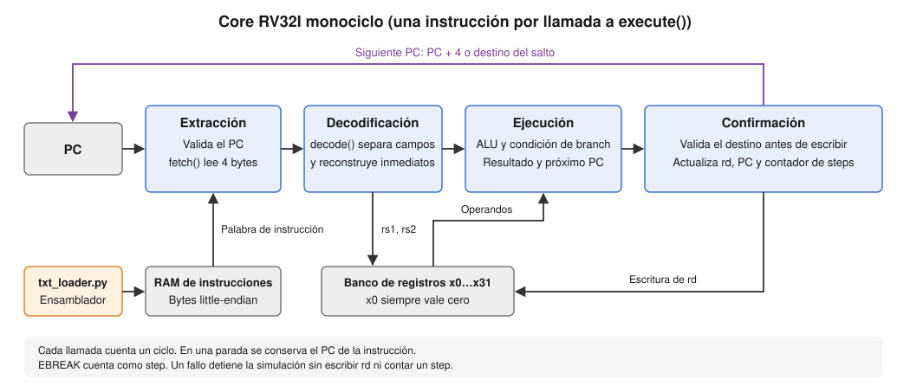
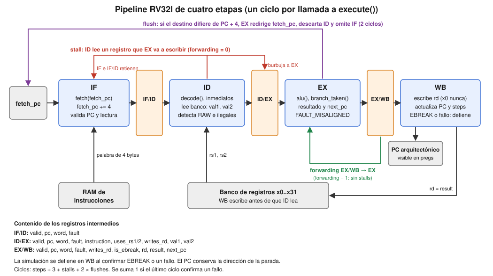

# Reporte final — Implementación y verificación de dos cores RV32I en Simics

- **Proyecto:** implementación de un core RV32I monociclo y un core RV32I con pipeline.
- **Entorno de verificación:** Intel Simics 7 (build 7214 win64).
- **Fecha de la regresión:** 16 de noviembre de 2026.

---

## Resumen

Este proyecto implementa dos modelos de procesador que ejecutan un subconjunto de instrucciones RV32I en Intel Simics: un core monociclo (`rv32-atomic`) y un core segmentado de cuatro etapas (`rv32-pipeline`). Ambos utilizan el mismo formato de programas de ensamblador, el mismo conjunto de instrucciones y una memoria RAM para almacenar y extraer instrucciones.

El core monociclo completa el ciclo de una instrucción mediante extracción, decodificación, ejecución y actualización del estado arquitectónico. El core pipeline distribuye el trabajo entre cuatro etapas concurrentes: IF (Instruction Fetch), ID (Instruction Decode), EX (Execute) y WB (Write Back). El pipeline usa interlock o forwarding para resolver dependencias RAW (*read after write*). Resuelve el control de flujo en EX y aplica los efectos arquitectónicos en WB.

La verificación del core monociclo se organiza por módulo y mediante programas de integración. La verificación del pipeline se organiza por etapa y por comportamiento del sistema completo. Se comparan los registros, el PC, los steps, el motivo de parada y los ciclos de ejecución.

El enunciado escrito fija cuatro etapas y limita las instrucciones a operaciones aritméticas, lógicas y de control de flujo. La RAM funciona como memoria de instrucciones. La verificación prueba la carga, la extracción y la conservación de esos bytes durante la ejecución.

> **Estado de la evidencia:** la [regresión completa en Simics 7](evidencia/regresion-simics7.md) confirmó los 30 casos de la matriz en los tres modos, 13 trazas, el cambio de forwarding y los cuatro rechazos de carga en ambos cores. [PRUEBAS.md](../PRUEBAS.md) separa los valores esperados de los resultados observados.

## 1. Objetivos

1. Implementar un core RV32I monociclo que ejecute el subconjunto de instrucciones definido por el proyecto.
2. Implementar un core RV32I segmentado en cuatro etapas, con ejecución concurrente.
3. Cargar programas desde archivos de texto y ejecutar las mismas pruebas en ambos cores.
4. Verificar los módulos del core monociclo.
5. Verificar cada etapa y el sistema completo del pipeline.
6. Comprobar el tratamiento de dependencias de datos y cambios de flujo de control.
7. Comparar los estados arquitectónicos finales de ambos cores.

## 2. Entorno y organización del proyecto

El proyecto se ejecuta sobre Intel Simics 7. Los componentes principales son:

| Ruta | Responsabilidad |
|---|---|
| `modules/rv32-atomic/` | Implementación del core monociclo |
| `modules/rv32-pipeline/` | Implementación del core segmentado |
| `targets/rv32i/` | Targets de Simics, configuración de máquina y programas |
| `targets/rv32i/programs/` | Programas de prueba en ensamblador RV32I |
| `CONVENTIONS.md` | Formato de los programas y conjunto de instrucciones |
| `PRUEBAS.md` | Planes, casos y resultados de verificación |
| `docs/pipeline-arquitectura.svg` | Diagrama existente de la arquitectura pipeline |
| `targets/rv32i/regresion.ps1` | Automatización de pruebas comparativas |
| `targets/rv32i/regresion-esperado.csv` | Estados y ciclos esperados para la regresión |

### 2.1. Formato de los programas

Los programas se escriben en archivos `.txt`, con una instrucción por línea. Se permiten líneas vacías y comentarios que comienzan con `#`. Los registros se identifican como `x0` a `x31`. Los inmediatos pueden expresarse en decimal o hexadecimal. Los offsets de branch y `JAL` son desplazamientos en bytes relativos al PC de la instrucción actual. No se utilizan etiquetas ni pseudoinstrucciones. `EBREAK` finaliza el programa.

### 2.2. Subconjunto implementado

| Categoría | Instrucciones |
|---|---|
| Inmediatos superiores | `LUI`, `AUIPC` |
| Saltos | `JAL`, `JALR` |
| Branches | `BEQ`, `BNE`, `BLT`, `BGE`, `BLTU`, `BGEU` |
| ALU con inmediato | `ADDI`, `SLTI`, `SLTIU`, `XORI`, `ORI`, `ANDI` |
| Desplazamientos inmediatos | `SLLI`, `SRLI`, `SRAI` |
| ALU entre registros | `ADD`, `SUB`, `SLL`, `SLT`, `SLTU`, `XOR`, `SRL`, `SRA`, `OR`, `AND` |
| Finalización | `EBREAK` |

El proyecto contempla 30 instrucciones del ejercicio, incluyendo `LUI`, `AUIPC` y `EBREAK`.

---

# 3. Diseño del core monociclo (`rv32-atomic`)

## 3.1. Descripción general

El core monociclo procesa una instrucción por llamada a `execute()`. Durante esa llamada se extrae la palabra de instrucción, se decodifican sus campos, se obtienen los operandos, se calcula el resultado o el nuevo PC y se actualiza el estado arquitectónico.

El estado principal del core está compuesto por:

- `pc`: dirección de la instrucción actual.
- `x[32]`: banco de registros de propósito general.
- Referencias al objeto y al core de Simics para acceder a memoria, registrar contadores y detener la simulación.

El registro `x0` siempre devuelve cero y no admite escrituras.

## 3.2. Flujo de ejecución

1. **Fetch:** se leen cuatro bytes desde la dirección indicada por `pc`. La palabra se reconstruye en formato little-endian.
2. **Decode:** se extraen `opcode`, `rd`, `funct3`, `rs1`, `rs2` y `funct7`; se reconstruyen y extienden los inmediatos.
3. **Execute:** se ejecuta la operación de ALU, se evalúa una condición de branch o se calcula el destino de un salto.
4. **Write back / actualización:** si corresponde, se escribe el registro destino; se actualiza el PC y se incrementa el contador de instrucciones completadas.

El core valida la alineación del destino antes de escribir el registro destino. En particular, un `JAL` con destino desalineado no debe sobrescribir el registro de enlace. Un branch no tomado no valida el destino codificado porque no lo utiliza.

## 3.3. Organización por módulos

| Módulo / archivo | Función dentro del diseño |
|---|---|
| `rv32-atomic.c` | Lógica del procesador: extracción, decodificación, ALU, branches, saltos, ejecución y desensamblado |
| `rv32-core.h` | Estado arquitectónico del core: PC, banco de registros y referencias a Simics |
| `rv32-core.c` | Adaptación del core a las interfaces de Simics; expone registros y PC, conecta extracción de memoria y parada |
| `rv32-helpers.h/.c` | Lectura/escritura de registros, protección de `x0`, lectura auxiliar de memoria, parada y contadores |
| `txt_loader.py` | Parser, validación, ensamblado y carga de instrucciones en RAM |
| `module_load.py` y target | Registro y configuración del módulo para Simics |

## 3.4. Diagrama del core monociclo



La confirmación actualiza el banco y selecciona el PC siguiente: `PC + 4`
o el destino calculado por un branch o salto. Si la instrucción causa una
parada, se conserva su PC.

## 3.5. Plan de verificación del core monociclo por módulo

La verificación se divide según las responsabilidades de los módulos y las funciones que implementan.

### 3.5.1. Cargador y ensamblador (`txt_loader.py`)

**Objetivo:** comprobar que el archivo de texto se analiza correctamente, que las instrucciones se codifican y que los argumentos inválidos se rechazan antes de ejecutar el core.

| Caso | Programa / entrada | Verificación | Resultado esperado |
|---|---|---|---|
| L01 | `01-arranque.txt` | Carga de instrucciones válidas | Dos palabras de instrucción escritas en RAM |
| L02 | `01-registro-fuera-de-rango.txt` | Registro `x32` | Rechazo: valor fuera de `[0, 31]` |
| L03 | `02-inmediato-fuera-de-rango.txt` | `ADDI` con inmediato 2048 | Rechazo: inmediato fuera de `[-2048, 2047]` |
| L04 | `03-desplazamiento-fuera-de-rango.txt` | `SLLI` con shift 32 | Rechazo: desplazamiento fuera de `[0, 31]` |
| L05 | `04-offset-impar.txt` | `BEQ` con offset 3 | Rechazo: el offset de branch debe ser par |

Los errores de carga se reportan con el archivo y el número de línea. Los cuatro casos negativos se documentan como rechazados en la línea 3.

### 3.5.2. Acceso a memoria y extracción (`fetch()` y `read_simics_memory()`)

**Objetivo:** verificar la lectura de instrucciones desde RAM, la reconstrucción little-endian y el tratamiento de fallos de extracción.

| Caso | Programa / preparación | Verificación | Resultado esperado |
|---|---|---|---|
| M01 | `01-arranque.txt` | Inspeccionar los primeros bytes de RAM | `x 0x0 8` muestra `9300 5000 7300 1000` |
| M02 | `01-arranque.txt` | Desensamblar dos instrucciones | `addi x1, x0, 5` y `ebreak` |
| M03 | `09-fuera-de-ram.txt`, `ram_size=0x10` | Saltar a la dirección `0x10` y extraer | Parada por `instruction fetch failed`, PC `0x10` |

Simics mostró la siguiente memoria y desensamblado antes de ejecutar `01-arranque.txt`.

```text
v:0x00000000  9300 5000 7300 1000                      ..P.s...
v:0x00000000 p:0x00000000  addi x1, x0, 5
v:0x00000004 p:0x00000004  ebreak
```

En little-endian, `93 00 50 00` es la palabra `0x00500093` y
`73 00 10 00` es `0x00100073`. En los tres modos, la regresión
comprobó que esos ocho bytes conservaban su valor al parar. También
comparó entre los cores los 216 bytes de `all-instructions.txt`, antes
y después de ejecutar sus 46 instrucciones confirmadas.

### 3.5.3. Decodificador y desensamblador (`decode()` y `rv32_disassemble()`)

**Objetivo:** verificar que los campos de cada formato y sus inmediatos se interpretan correctamente.

| Caso | Programa | Verificación |
|---|---|---|
| D01 | `all-instructions.txt` | Reconocimiento de todas las instrucciones admitidas |
| D02 | `03-bucle.txt` | Extensión de signo del offset negativo del branch |
| D03 | `04-enlace.txt` | Decodificación de `JAL` y `JALR` |
| D04 | Inyección `0x02101113` | Rechazo de una codificación no soportada |

Para D04, cargar `08-palabra-ilegal.txt` e inyectar la palabra en `0x04` antes de ejecutar. El resultado esperado es `illegal or unsupported instruction 0x02101113 at 0x00000004`.

### 3.5.4. ALU (`alu()` y `arithmetic_right()`)

**Objetivo:** verificar las operaciones aritméticas y lógicas, los resultados de 32 bits, las comparaciones con y sin signo y los desplazamientos.

El programa `02-alu-limites.txt` cubre:

- Suma y resta con conservación de los 32 bits menos significativos.
- Comparaciones signed y unsigned.
- Extensión de signo del inmediato utilizado por `SLTIU`.
- Desplazamientos de cero y de 31 posiciones.
- Diferencia entre `SRAI` y `SRLI`.
- Protección de `x0`.

Estado esperado relevante:

| Registro | Valor esperado |
|---|---:|
| `x1` | `0xffffffff` |
| `x2` | `0x00000000` |
| `x3` | `0x00000001` |
| `x4` | `0x00000000` |
| `x6` | `0xffffffff` |
| `x7` | `0x00000001` |
| `x8` | `0x80000000` |
| `x9` | `0x7fffffff` |
| `x10` | `0x00000001` |

### 3.5.5. Branches, saltos y actualización del PC

**Objetivo:** verificar las condiciones de branch, el cálculo de destinos y las direcciones de retorno.

| Caso | Programa | Verificación | Resultado esperado |
|---|---|---|---|
| C01 | `03-bucle.txt` | `BNE` tomado dos veces y luego no tomado | `x1=0`, `x2=7`, PC `0x10` |
| C02 | `04-enlace.txt` | `JAL` y `JALR`, registro de enlace y limpieza del bit 0 | `x5=0x04`, `x6=0x14`, `x9=1`, PC `0x08` |
| C03 | `05-branch-desalineado.txt` | Branch tomado hacia `0x06` | Parada por destino desalineado, PC `0x04` |
| C04 | `06-jal-desalineado.txt` | `JAL` hacia `0x06` | Parada sin sobrescribir `x5` |
| C05 | `07-branch-no-tomado.txt` | Branch no tomado con destino codificado desalineado | Continúa normalmente hasta EBREAK |

### 3.5.6. Banco de registros, helpers y contadores

**Objetivo:** verificar la semántica de los registros y la integración de los contadores de Simics.

- `reg_read_x()` devuelve cero para `x0`.
- `reg_write_x()` ignora escrituras a `x0`.
- `increment_cycle()` suma una llamada a `execute()`.
- `increment_step()` suma una instrucción completada.
- `EBREAK` cuenta como step.
- Un fallo de extracción, instrucción ilegal o destino desalineado no cuenta como instrucción completada.
- `pregs` permite observar los registros y el PC.
- `ptime` permite observar steps y cycles.

El caso `02-alu-limites.txt` comprueba las escrituras a `x0`. El volcado final mostró `x0=0` y `ptime` registró 12 steps y 12 ciclos. En el caso de palabra ilegal el volcado registró 1 step y 2 ciclos, pues solo se confirmó el ADDI anterior.

## 3.6. Resultados del core monociclo

`PRUEBAS.md` documenta que los cinco programas positivos, los cuatro errores de carga y los cinco casos de ejecución/control fueron observados en Simics 7 y coincidieron con los resultados esperados.

### Programas positivos

| Programa | Capacidad verificada | PC final | Steps | Cycles |
|---|---|---:|---:|---:|
| `01-arranque.txt` | Carga, fetch, ADDI, escritura y EBREAK | `0x04` | 2 | 2 |
| `02-alu-limites.txt` | ALU, comparaciones, shifts y `x0` | `0x2c` | 12 | 12 |
| `03-bucle.txt` | Branch tomado y no tomado | `0x10` | 9 | 9 |
| `04-enlace.txt` | JAL y JALR | `0x08` | 5 | 5 |
| `all-instructions.txt` | Integración del subconjunto completo | `0xd4` | 46 | 46 | 

Estado final esperado y observado de `all-instructions.txt`:

```text
x0  = 0x00000000   x1  = 0x12345000   x2  = 0x00000004   x3  = 0x00000064
x4  = 0xfffffff9   x5  = 0x00000001   x6  = 0x00000000   x7  = 0x0000009b
x8  = 0x00000764   x9  = 0x000000f0   x10 = 0x00000640   x11 = 0x0000000f
x12 = 0xfffffffc   x13 = 0x0000005d   x14 = 0xffffff95   x15 = 0x000000c8
x16 = 0x00000001   x17 = 0x00000000   x18 = 0xffffff9d   x19 = 0x7ffffffc
x20 = 0xfffffffc   x21 = 0x000000f4   x22 = 0x00000060   x23 = 0x00000006
x24 = 0x00000000   x25 = 0x000000bc   x26 = 0x000000c0   x27 = 0x000000c8
x28 = 0x00000064   x29 = 0x00000000   x30 = 0x00000000   x31 = 0x00000000
pc  = 0x000000d4
```

### Errores de carga

| Programa | Resultado observado |
|---|---|
| `01-registro-fuera-de-rango.txt` | Rechazado: `Value 32 out of range [0, 31]` |
| `02-inmediato-fuera-de-rango.txt` | Rechazado: `Value 2048 out of range [-2048, 2047]` |
| `03-desplazamiento-fuera-de-rango.txt` | Rechazado: `Value 32 out of range [0, 31]` |
| `04-offset-impar.txt` | Rechazado: `Branch offset must be even: 3` |

### Errores de ejecución y control

| Programa | Resultado observado |
|---|---|
| `05-branch-desalineado.txt` | `unaligned instruction fetch`, PC `0x04`, `x1=5`, `x2=0`; 1 step y 2 cycles |
| `06-jal-desalineado.txt` | `unaligned instruction fetch`, PC `0x04`, `x5=7`, `x2=0`; 1 step y 2 cycles |
| `07-branch-no-tomado.txt` | Continúa hasta EBREAK, PC `0x0c`, `x1=5`, `x2=9`; 4 steps y 4 cycles |
| `08-palabra-ilegal.txt` | `illegal or unsupported instruction 0x02101113 at 0x00000004`; 1 step y 2 cycles |
| `09-fuera-de-ram.txt` | `instruction fetch failed`, PC `0x10`; 2 steps y 3 cycles |

La [regresión](evidencia/regresion-simics7.md) registró 46 steps y 46
cycles en el monociclo para `all-instructions.txt`. El caso de PC inicial
`0x02` se detuvo por desalineación con 0 steps y 1 cycle.

---

# 4. Diseño del core pipeline (`rv32-pipeline`)

## 4.1. Descripción general

El core pipeline implementa cuatro etapas concurrentes:

1. **IF — Instruction Fetch:** extrae una instrucción de RAM usando `fetch_pc`.
2. **ID — Instruction Decode:** decodifica la instrucción, identifica los registros fuente y lee sus valores.
3. **EX — Execute:** ejecuta la operación, calcula el resultado y resuelve el flujo de control.
4. **WB — Write Back:** actualiza el banco de registros y confirma la instrucción.

Las etapas se separan mediante tres registros intermedios: IF/ID, ID/EX y EX/WB. Cada llamada a `execute()` avanza el pipeline un ciclo. Las etapas calculan el estado siguiente usando el estado que existía al comienzo del ciclo; después se aplican los cambios, evitando que una instrucción atraviese varias etapas en una sola llamada.

## 4.2. Estado y registros intermedios

El archivo `modules/rv32-pipeline/rv32-core.h` declara el estado del pipeline.

| Registro | Campos principales | Función |
|---|---|---|
| IF/ID | `valid`, `pc`, `word`, `fault` | Conserva la instrucción extraída y su PC |
| ID/EX | `valid`, `pc`, `word`, `fault`, `instruction`, operandos, `uses_rs1`, `uses_rs2`, `writes_rd` | Transporta la instrucción y los operandos hacia EX |
| EX/WB | `valid`, `pc`, `word`, `fault`, `writes_rd`, `is_ebreak`, `rd`, `result`, `next_pc` | Transporta el resultado y los efectos hacia WB |

El core mantiene dos direcciones distintas:

- `fetch_pc`: dirección de la próxima extracción, que puede ir por delante.
- `pc`: PC arquitectónico visible desde Simics, actualizado cuando una instrucción se confirma en WB.

Cada registro intermedio tiene un indicador `valid`. Un registro inválido representa una burbuja y no puede producir escrituras ni incrementar steps.

## 4.3. Responsabilidad de las etapas

### IF — Instruction Fetch

- Comprueba que `fetch_pc` sea múltiplo de cuatro antes de leer los cuatro bytes de RAM.
- Reconstruye la palabra de instrucción en little-endian.
- Guarda la palabra y el PC original en IF/ID.
- Avanza `fetch_pc` cuatro bytes si la lectura fue exitosa.
- Si falla la lectura, transporta `FAULT_FETCH` por el pipeline; la simulación no se detiene inmediatamente porque esa instrucción todavía podría pertenecer a un camino que luego sea descartado.

### ID — Instruction Decode

- Decodifica los campos de la instrucción.
- Reconstruye los inmediatos.
- Identifica qué registros fuente utiliza cada formato.
- Lee los valores del banco de registros.
- Determina si la instrucción escribe en `rd`.
- Detecta una dependencia RAW con la instrucción que está en EX cuando el forwarding está desactivado.
- Si existe esa dependencia, conserva la instrucción en ID, detiene IF e inserta una burbuja hacia EX.

### EX — Execute

- Ejecuta las operaciones de ALU.
- Calcula destinos de branch, `JAL` y `JALR`.
- Evalúa las condiciones de branch.
- Aplica forwarding EX/WB → EX cuando está habilitado.
- Detecta destinos desalineados.
- Si el flujo de control cambia, redirige `fetch_pc` e invalida las instrucciones jóvenes que pertenecen al camino anterior.

### WB — Write Back

- Es la etapa que confirma la instrucción más antigua.
- Escribe el resultado en el registro destino cuando corresponde.
- Conserva `x0=0`.
- Actualiza el PC arquitectónico.
- Incrementa steps para instrucciones confirmadas, incluido EBREAK.
- Detiene la simulación cuando EBREAK o un fallo llegan a WB.

## 4.4. Riesgos de datos: interlock y forwarding

El riesgo de datos cubierto es RAW (*Read After Write*): una instrucción consumidora necesita un registro que una instrucción anterior todavía no ha actualizado.

Ejemplo de dependencia:

```asm
addi x1, x0, 10
addi x2, x1, 5
ebreak
```

La segunda instrucción requiere el valor de `x1` producido por la primera.

El diseño permite ejecutar en dos modos:

- **Interlock (`forwarding = 0`):** si ID detecta que la instrucción en EX va a escribir un registro que la instrucción en ID necesita, mantiene la instrucción en ID, detiene IF e inserta una burbuja en EX.
- **Forwarding (`forwarding = 1`):** EX recibe el resultado de la instrucción anterior desde EX/WB, sin esperar a que el consumidor vuelva a leer el valor actualizado del banco.

El forwarding también se utiliza para los operandos de branches y para `JALR`. Las escrituras a `x0` no generan dependencias. Para la organización de cuatro etapas implementada, una dependencia de distancia 1 requiere un stall con interlock; una dependencia de distancia 2 puede leer el valor porque WB escribe antes de que ID lea en ese ciclo. Cambiar el modo con Simics en pausa descarta los registros intermedios y vuelve a extraer desde el PC arquitectónico, sin perder las instrucciones confirmadas.

## 4.5. Riesgos de control: branches y saltos

Los branches se evalúan en EX. Cuando un branch es tomado o una instrucción `JAL`/`JALR` cambia el flujo:

1. EX calcula el destino usando el PC original de la instrucción.
2. Se valida la alineación del destino.
3. Se redirige `fetch_pc`.
4. Se invalidan las instrucciones jóvenes en ID e IF.
5. La extracción continúa desde el destino correcto.

Cuando el destino difiere de `PC + 4`, la redirección descarta la instrucción de ID y omite la lectura de IF. La traza lo registra como `flush`. Las instrucciones descartadas no pueden escribir registros, incrementar steps ni detener Simics.

Los branches no tomados no generan flush. La alineación de un destino de branch solo se comprueba si la condición se cumple. `JALR` elimina el bit menos significativo de la dirección calculada antes de validar que el destino sea múltiplo de cuatro.

## 4.6. Finalización y fallos

EBREAK y los fallos viajan con la instrucción hasta WB. Esto conserva el orden de confirmación:

- EBREAK detiene la simulación cuando llega a WB. Al reconocerlo en ID, el core para la extracción para no leer después de la última instrucción.
- Una instrucción ilegal detiene la simulación al llegar a WB.
- Un fallo de lectura o un PC de extracción desalineado se transporta hasta WB.
- Un destino desalineado no permite escribir el registro destino.
- Una instrucción de un camino descartado no puede detener el programa.

El contador de cycles incrementa una vez por llamada a `execute()`, incluso durante llenado, stalls o flushes. El contador de steps incrementa cuando una instrucción válida se confirma en WB, incluido EBREAK.

## 4.7. Diagrama del pipeline



---

# 5. Verificación del pipeline

## 5.1. Verificación por etapa

La verificación por etapa utiliza programas dirigidos y trazas de nivel 3 (`log-level 3`), que muestran qué instrucción ocupa IF, ID, EX y WB en cada ciclo.

| Etapa | Caso | Qué se comprueba | Evidencia esperada |
|---|---|---|---|
| IF | `01-arranque.txt` | Dirección y palabra extraída | IF avanza desde `0x0` a `0x4`; la instrucción anterior aparece en ID |
| IF | `09-fuera-de-ram.txt`, `ram_size=0x10` | Fallo de lectura | `FETCH-FAIL` viaja hasta WB y detiene con PC `0x10` |
| IF/EX | H13, 12 bytes de RAM | Fallo de lectura especulativa tras un salto | `FETCH-FAIL` se ve en ID, pero no llega a WB. Termina con PC `0x04` y 3 steps |
| ID | `03-bucle.txt`, H10 | Decodificación de inmediatos y registros | Aparecen `addi x1, x1, -1` y branches con offsets correctos |
| ID | H01 con interlock | Detección de RAW | Mensaje `stall:` y burbuja en EX |
| ID | Palabra ilegal inyectada | Detección de instrucción no soportada | `.word 0x02101113` y fallo al llegar a WB |
| EX | `02-alu-limites.txt` | Resultado de ALU | Estado final igual al monociclo |
| EX | H01 con forwarding | Selección de operando reenviado | `forward: ... x1 <- 0000000a (EX/WB)` |
| EX | H10 y H07 | Branch y JALR | Mensaje `flush:` con PC de origen y destino |
| WB | P01 y H09 | Escrituras, protección de `x0` y steps | `x0=0`; steps iguales a instrucciones confirmadas |
| WB | H11 | EBREAK en camino descartado | El EBREAK de `0x0c` no detiene; se detiene el de `0x18` |

## 5.2. Verificación del sistema completo

Se reutilizan los programas del core monociclo y se agregan programas específicos del pipeline.

### Programas de riesgos y control de flujo

| Programa | Propósito | Estado esperado resumido | Stalls / flushes | Ciclos interlock / forwarding |
|---|---|---|---:|---:|
| H01 `h01-raw-addi.txt` | RAW entre ADDI consecutivos | `x1=10`, `x2=15`, PC `0x08`; 3 steps | 1 / 0 | 7 / 6 |
| H02 `h02-raw-add-sub.txt` | Dos dependencias RAW consecutivas | `x1=6`, `x2=2`, `x3=8`, `x4=2`; 5 steps | 2 / 0 | 10 / 8 |
| H03 `h03-raw-rs2.txt` | Dependencia únicamente por `rs2` | `x1=4`, `x2=9`, `x3=0xfffffffb`; 4 steps | 1 / 0 | 8 / 7 |
| H04 `h04-mismo-registro.txt` | Cadena de escrituras/lecturas del mismo registro | `x1=10`; 5 steps | 3 / 0 | 11 / 8 |
| H05 `h05-distancia-2.txt` | Productor a distancia 2 | `x1=5`, `x2=6`, `x3=10`; 4 steps | 0 / 0 | 7 / 7 |
| H06 `h06-branch-dependiente.txt` | Branch tomado dependiente de resultados recientes | `x1=3`, `x2=3`, `x3=0`, `x4=4`; 5 steps | 2 / 1 | 12 / 10 |
| H07 `h07-jalr-dependiente.txt` | JALR dependiente de un resultado reciente | `x1=16`, `x2=8`, `x3=0`, `x4=4`; 4 steps | 1 / 1 | 10 / 9 |
| H08 `h08-dos-operandos.txt` | RAW simultáneo por `rs1` y `rs2` | `x1=3`, `x2=6`; 3 steps | 1 / 0 | 7 / 6 |
| H09 `h09-x0-sin-dependencia.txt` | `x0` no produce dependencias | `x0=0`, `x1=0`, `x2=1`, `x3=0`; 5 steps | 0 / 0 | 8 / 8 |
| H10 `h10-branch-tomado.txt` | Branch tomado descarta dos instrucciones jóvenes | `x1=1`, `x2=0`, `x3=0`, `x4=4`, `x9=9`; 5 steps | 0 / 1 | 10 / 10 |
| H11 `h11-ebreak-descartado.txt` | EBREAK del camino descartado no detiene | `x1=1`, `x2=0`, `x3=3`, `x4=4`; 5 steps | 0 / 1 | 10 / 10 |
| H12 `h12-branch-no-tomado.txt` | Branch dependiente no tomado | `x1=1`, `x2=2`, `x3=3`, `x4=4`; 6 steps | 1 / 0 | 10 / 9 |
| H13 `h13-fetch-descartado.txt` | Salto desde la última palabra de RAM | Registros en cero, PC `0x04`, RAM intacta, 3 steps | 0 / 2 | 10 / 10 |
| P01 `p01-independientes.txt` | 25 instrucciones independientes y llenado/vaciado | 25 steps, PC `0x60` | 0 / 0 | 28 / 28 |

Los ciclos esperados de la tabla coincidieron con los de la [regresión en Simics 7](evidencia/regresion-simics7.md).

### Pruebas heredadas del core monociclo

También se ejecutan en el pipeline:

- Los cinco programas positivos del core monociclo.
- Los cuatro archivos de errores de carga.
- Los casos de branch desalineado, JAL desalineado, branch no tomado con destino codificado desalineado, palabra ilegal y fetch fuera de RAM.
- El programa `all-instructions.txt`, que cubre el subconjunto completo.

El criterio de equivalencia es que ambos cores terminen con los mismos registros, PC, steps, motivo de parada y contenido de RAM. La regresión verifica la RAM en los casos de arranque, el programa de integración y H13.

## 5.3. Traza de espera por dependencia (H01)

Programa:

```asm
addi x1, x0, 10
addi x2, x1, 5
ebreak
```

La segunda instrucción requiere el resultado de `x1`, que está siendo calculado por la instrucción anterior en EX. Con interlock, ID conserva la instrucción dependiente, IF deja de avanzar y se inserta una burbuja en EX.

Traza registrada:

```text
[core0 info]  IF: 00000000 ID: ---------------- EX: ---------------- WB: ----------------
[core0 info]  IF: 00000004 ID: 00000000 addi x1, x0, 10 EX: ---------------- WB: ----------------
[core0 info]  IF: 00000008 ID: 00000004 addi x2, x1, 5 EX: 00000000 addi x1, x0, 10 WB: ----------------
[core0 info] stall: 00000004 addi waits for an operand from EX
[core0 info]  IF: 00000008 ID: 00000004 addi x2, x1, 5 EX: ---------------- WB: 00000000 addi x1, x0, 10
[core0 info]  IF: 0000000c ID: 00000008 ebreak EX: 00000004 addi x2, x1, 5 WB: ----------------
[core0 info]  IF: (stopped) ID: ---------------- EX: 00000008 ebreak WB: 00000004 addi x2, x1, 5
[core0 info]  IF: (stopped) ID: ---------------- EX: ---------------- WB: 00000008 ebreak
[core0 info] halted at pc 0x00000008: ebreak
```

Resultado: `x1=10`, `x2=15`, PC `0x08`, 3 steps y 7 cycles.

Con forwarding habilitado, la instrucción consumidora recibe el valor de `x1` desde EX/WB y no requiere el stall:

```text
[core0 info]  IF: 00000000 ID: ---------------- EX: ---------------- WB: ----------------
[core0 info]  IF: 00000004 ID: 00000000 addi x1, x0, 10 EX: ---------------- WB: ----------------
[core0 info]  IF: 00000008 ID: 00000004 addi x2, x1, 5 EX: 00000000 addi x1, x0, 10 WB: ----------------
[core0 info]  IF: 0000000c ID: 00000008 ebreak EX: 00000004 addi x2, x1, 5 WB: 00000000 addi x1, x0, 10
[core0 info] forward: 00000004 x1 <- 0000000a (EX/WB)
[core0 info]  IF: (stopped) ID: ---------------- EX: 00000008 ebreak WB: 00000004 addi x2, x1, 5
[core0 info]  IF: (stopped) ID: ---------------- EX: ---------------- WB: 00000008 ebreak
[core0 info] halted at pc 0x00000008: ebreak
```

Resultado: mismo estado arquitectónico, 3 steps y 6 cycles.

## 5.4. Traza de salto que descarta instrucciones (H10)

El programa H10 realiza un `BNE` tomado desde `0x08` hacia `0x14`. En ese momento, una instrucción señuelo se encuentra en ID y otra dirección está pendiente de extracción en IF. Ambas pertenecen al camino incorrecto y deben descartarse.

Fragmento de la traza observada en Simics 7:

```text
[core0 info]  IF: 00000010 ID: 0000000c addi x2, x0, 99 EX: 00000008 bne x1, x0, 12 WB: 00000004 addi x9, x0, 9
[core0 info] flush: redirect from 00000008 to 00000014, discard ID and IF
[core0 info]  IF: 00000014 ID: ---------------- EX: ---------------- WB: 00000008 bne x1, x0, 12
[core0 info]  IF: 00000018 ID: 00000014 addi x4, x0, 4 EX: ---------------- WB: ----------------
[core0 info]  IF: 0000001c ID: 00000018 ebreak EX: 00000014 addi x4, x0, 4 WB: ----------------
[core0 info]  IF: (stopped) ID: ---------------- EX: 00000018 ebreak WB: 00000014 addi x4, x0, 4
[core0 info]  IF: (stopped) ID: ---------------- EX: ---------------- WB: 00000018 ebreak
[core0 info] halted at pc 0x00000018: ebreak
```

El resultado esperado es que las instrucciones descartadas no modifiquen `x2` ni `x3`. El estado final es `x1=1`, `x2=0`, `x3=0`, `x4=4`, `x9=9`, PC `0x18`, 5 steps y 10 cycles.

## 5.5. Resultados en Simics 7

La [salida de la regresión](evidencia/regresion-simics7.md) contiene los
resultados de cada caso, con 112 sesiones completadas sin fallos. Las
pruebas reproducen también un `ebreak` en la última palabra de RAM,
un PC inicial desalineado y un cambio de forwarding con una dependencia RAW
en vuelo. Los resultados de esos tres casos se detallan en
[PRUEBAS.md](../PRUEBAS.md#casos-de-la-revisión).

---

# 6. Comparación entre el core monociclo y el pipeline

## 6.1. Comparación arquitectónica

| Característica | `rv32-atomic` | `rv32-pipeline` |
|---|---|---|
| Organización | Una instrucción por llamada a `execute()` | Cuatro etapas concurrentes |
| Etapas | Fetch, decode, execute y actualización | IF, ID, EX, WB |
| Estado de ejecución | PC y banco de registros | PC arquitectónico, `fetch_pc`, banco y tres registros intermedios |
| Dependencias RAW | No hay instrucciones simultáneas en vuelo | Interlock o forwarding |
| Branch y jumps | Se resuelven durante la ejecución de la instrucción | Se resuelven en EX |
| Instrucciones del camino incorrecto | No aplica | Se descartan mediante flush |
| Steps | Instrucciones completadas | Instrucciones confirmadas en WB |
| Cycles | Una llamada por instrucción intentada | Una llamada por ciclo de pipeline |
| Finalización | EBREAK durante la ejecución | EBREAK al llegar a WB |

## 6.2. Comparación de ciclos

La referencia de `PRUEBAS.md` utiliza la siguiente relación para el pipeline:

```text
cycles = steps + 3 + stalls + 2 × flushes
```

En los programas que terminan por un fallo se agrega un ciclo por la instrucción defectuosa:

```text
cycles = steps + 3 + stalls + 2 × flushes + 1
```

Los tres ciclos adicionales representan el llenado del pipeline. Cada stall agrega un ciclo. Cada redirección a un destino distinto de `PC + 4` vacía ID y omite IF, lo que agrega dos ciclos.

Ejemplos documentados:

| Programa | Steps | Monociclo | Pipeline interlock | Pipeline forwarding |
|---|---:|---:|---:|---:|
| `01-arranque.txt` | 2 | 2 | 5 | 5 |
| `02-alu-limites.txt` | 12 | 12 | 18 | 15 |
| `03-bucle.txt` | 9 | 9 | 20 | 16 |
| `04-enlace.txt` | 5 | 5 | 13 | 12 |
| `all-instructions.txt` | 46 | 46 | 67 | 65 |
| H01 | 3 | 3 | 7 | 6 |
| H02 | 5 | 5 | 10 | 8 |
| H03 | 4 | 4 | 8 | 7 |
| H10 | 5 | 5 | 10 | 10 |

Los ciclos observados coincidieron con los valores esperados en los tres modos.

El forwarding reduce los stalls causados por dependencias RAW. No elimina el coste de llenado ni el coste de los flushes por cambios de flujo de control. En programas sin dependencias que requieran espera, interlock y forwarding pueden tener el mismo número de ciclos.

## 6.3. Criterio de equivalencia

Para un mismo programa y estado inicial, ambos cores deben producir:

- Los mismos valores para `x0` a `x31`.
- El mismo PC arquitectónico final.
- El mismo motivo de parada.
- El mismo número de steps para las mismas instrucciones completadas.
- Los mismos bytes en la RAM de instrucciones antes y después de ejecutar.

El número de cycles puede ser diferente por la segmentación, el llenado, los stalls y los flushes.

---

# 7. Procedimiento para reproducir pruebas y obtener evidencia

Todos los comandos siguientes se ejecutan desde PowerShell, en la raíz del proyecto Simics.

## 7.1. Compilar los módulos

```powershell
.\bin\make.bat rv32-atomic
.\bin\make.bat rv32-pipeline
```

Después de modificar archivos `.c`, `.h` o `txt_loader.py`, se debe volver a compilar el módulo correspondiente y reiniciar Simics.

## 7.2. Ejecutar el core monociclo

Ejemplo con el programa completo:

```powershell
.\simics.bat targets\rv32i\rv32-atomic.simics program=targets/rv32i/programs/all-instructions.txt
```

En la consola de Simics:

```text
run 64 cycles
pregs
ptime
```

Para evidenciar la carga de instrucciones:

```text
x 0x0 8
disassemble 0x0 2
```

Tomar capturas de `pregs`, `ptime` y de la memoria/desensamblado. Para que los contadores se vean correctamente, ejecutar `pregs` y `ptime` después de que termine `run`.

## 7.3. Ejecutar la regresión completa

Este es el paso necesario para confirmar el conjunto completo de pruebas del pipeline en Simics:

```powershell
.\targets\rv32i\regresion.ps1
```

El script ejecuta cada programa en sesiones nuevas de Simics en tres modos:

1. Core monociclo.
2. Pipeline con interlock (`forwarding=0`).
3. Pipeline con forwarding (`forwarding=1`).

Compara registros, PC, steps, motivo de parada y ciclos. También comprueba RAM en los casos que especifican `verify_ram_bytes`, las trazas, el cambio de forwarding y los cuatro errores de carga de cada core. El resultado se guarda en `regresion-salida\resultados.md`, con las salidas individuales en la misma carpeta.

Una regresión completa satisfactoria debe terminar con el mensaje:

```text
Regresion completa: todo OK.
```

Si aparece `FALLA`, revisar `regresion-salida\resultados.md` y las salidas individuales antes de cerrar el reporte.

## 7.4. Capturar la traza de dependencia H01

Interlock:

```powershell
.\simics.bat targets\rv32i\regresion.simics core_kind=pipeline forwarding=0 log_level=3 program=targets/rv32i/programs/pipeline/h01-raw-addi.txt
```

Forwarding:

```powershell
.\simics.bat targets\rv32i\regresion.simics core_kind=pipeline forwarding=1 log_level=3 program=targets/rv32i/programs/pipeline/h01-raw-addi.txt
```

En las salidas se debe identificar:
- Con `forwarding=0`: `stall: 00000004 addi ...`.
- Con `forwarding=1`: `forward: 00000004 x1 <- 0000000a (EX/WB)`.
- El mismo estado final: `x1=10`, `x2=15`, PC `0x08`, 3 steps.

## 7.5. Capturar la traza de salto y flush H10

```powershell
.\simics.bat targets\rv32i\regresion.simics core_kind=pipeline forwarding=0 log_level=3 program=targets/rv32i/programs/pipeline/h10-branch-tomado.txt
```

En la salida se debe identificar el mensaje equivalente a:

```text
flush: redirect from 00000008 to 00000014, discard ID and IF
```

Después, comprobar que `x2` y `x3` permanecen en cero y que la ejecución termina en el EBREAK del destino.

La traza observada se incluye en la sección 5.4. Las salidas completas quedan en el directorio de la regresión.

---

# 8. Limitaciones y decisiones de diseño

1. **Cuatro etapas:** se implementan IF, ID, EX y WB, de acuerdo con el alcance seleccionado para el proyecto. No se incluye una etapa MEM separada.
2. **Sin load/store de datos:** el conjunto definido en `CONVENTIONS.md` no incluye `LW`, `SW` ni otras instrucciones de acceso a memoria de datos. La RAM se utiliza para almacenar y extraer instrucciones.
3. **Dependencias:** se cubren las dependencias RAW mediante interlock y forwarding EX/WB → EX. El control `forwarding` permite ejecutar ambos modos y comparar sus ciclos.
4. **Control de flujo.** Los saltos se resuelven en EX. Si una lectura especulativa falla antes de que EX redirija, la infraestructura de Simics puede registrar el error inmediatamente. H13 verifica que esa lectura descartada nunca alcanza WB y que el core termina en el `ebreak` esperado.

---

# 9. Conclusiones

Se desarrollaron dos modelos de procesador que comparten el mismo subconjunto de instrucciones RV32I y el mismo formato de programas. El core monociclo sirve como referencia funcional y permite verificar por separado el cargador, la extracción de instrucciones, la decodificación, la ALU, el control de flujo, el banco de registros y la integración con Simics.

El core pipeline organiza la ejecución en cuatro etapas concurrentes y añade mecanismos para mantener la equivalencia arquitectónica con el monociclo. El interlock introduce esperas cuando una instrucción necesita un resultado que todavía se está calculando. El forwarding permite entregar ese resultado directamente a EX y eliminar esas esperas. Los branches y saltos se resuelven en EX y provocan el descarte de instrucciones del camino incorrecto cuando corresponde.

Las pruebas del core monociclo documentadas en `PRUEBAS.md` cubren el subconjunto completo, casos límite de la ALU, saltos, branches, errores de carga y errores de ejecución. Para el pipeline, el repositorio incluye pruebas por etapa y programas dirigidos para dependencias, forwarding, stalls, branches, saltos, `x0`, EBREAK descartado y llenado/vaciado. La regresión completa en Simics 7 confirmó la equivalencia arquitectónica para toda la matriz y las diferencias de ciclos esperadas entre los modos.

El criterio final de corrección es que, al ejecutar el mismo programa desde el mismo estado inicial, ambos cores produzcan el mismo estado arquitectónico, aunque el número de ciclos sea diferente debido al funcionamiento del pipeline.

---

# 10. Referencias del proyecto

- `README.md` — compilación, ejecución y regresión.
- `CONVENTIONS.md` — formato y conjunto de instrucciones.
- `PRUEBAS.md` — plan de verificación, estados esperados, trazas y resultados.
- `TODO.md` — estado del proyecto y mapa de implementación.
- `modules/rv32-atomic/` — implementación del core monociclo.
- `modules/rv32-pipeline/` — implementación del core pipeline.
- `targets/rv32i/regresion.ps1` — automatización de la regresión.
- `targets/rv32i/regresion-esperado.csv` — valores esperados de la regresión.
- `docs/pipeline-arquitectura.svg` — diagrama del pipeline.
